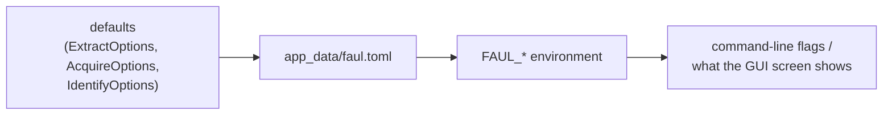

# Settings

The defaults of `extract`, `acquire` and `identify` (CLI and GUI alike) can be
changed once, instead of on every command line. Each layer replaces only the
values it names, lowest first:



- **Defaults** are written in one place only: the library's option dataclasses.
  The one app-level difference is `jobs = 0` ("auto": one parser per physical
  core, capped at 8, reduced on low memory).
- **The file** is `app_data/faul.toml`, next to `faul.py` (git-ignored, like the
  rest of `app_data/`). It does not exist until you create it.
- **The environment** overrides the file: `FAUL_<SECTION>_<FIELD>`, upper case,
  dots as underscores.
- **A flag** you give, or a value the GUI screen offers, wins. A flag you leave out
  means "the settings decide". Boolean options have a `--no-…` form
  (`--no-fts`, `--no-fast-write`), so a setting can be overridden either way.

## The file

```toml
[extract]
jobs = 4                    # 0 = auto
integrity = "fingerprint"   # full | fingerprint | off
fts = true
fast_fts = true
fast_write = false
keep_raw = false
batch_size = 100000

[acquire]
pack = true                 # false = loose .logarchive + sidecar (like --raw)
size_limit = 2000000000     # bytes
age_limit = 7               # days

[identify]
still_seconds = 30
write_csv = true

[identify.extract]          # how identify's two captures are extracted
batch_size = 1000
jobs = 0
fts = false
integrity = "off"
```

The same keys as environment variables: `FAUL_EXTRACT_JOBS=4`,
`FAUL_ACQUIRE_PACK=false`, `FAUL_IDENTIFY_EXTRACT_BATCH_SIZE=5000`. In the
environment, booleans are `true/false/yes/no/on/off/1/0`, and `none` (or empty)
clears an optional number such as `size_limit`.

## What cannot be a setting

Choices that must be made for each run are not settable, so a file nobody
looks at can never make them: `overwrite` (would replace an evidence database),
the audit log (an evidence extract is the command's decision), `work_dir`, and
the device `udid`.

## Errors

Every problem is refused, all of them in one message: an unknown key or
`FAUL_*` variable (with a "did you mean" hint), a value of the wrong type, or an
invalid value (`batch_size = 0`, `integrity = "most"`). The CLI then stops with
exit code `2` before doing anything; the GUI shows the message and does not
start the run. Running with a setting you believe is applied, when it is not, is
worse than not running.

## See also

- [CLI reference](cli/index.md) — every flag and its default.
- `app/settings.py` — the loader (`SETTABLE_KEYS` is the full list).
